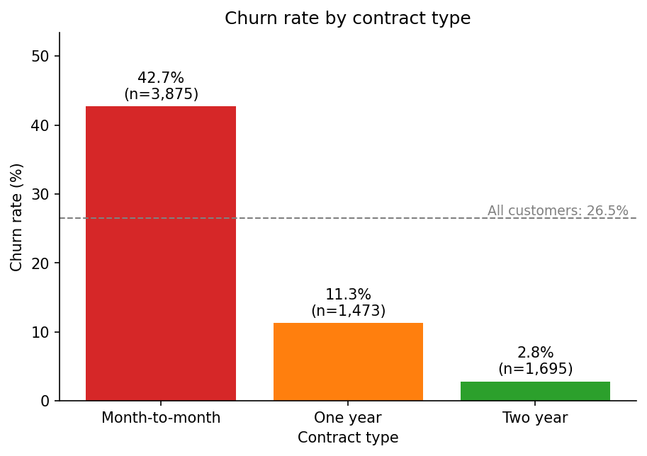

# Telco Customer Churn Prediction

[](https://github.com/ArvinKuo/python_skill/actions/workflows/ci.yml)

A small, tested Python project that checks, cleans and explores telecom
customer data, trains a Logistic Regression model to predict which customers
are likely to leave (churn), and writes a risk score for each customer.

**Results at a glance** (test set of 1,409 customers the model never saw):
accuracy **0.806**, precision **0.658**, recall **0.561**, F1 **0.606**. The
model catches 210 of 374 churners and misses 164.
[Details ↓](#evaluation-metrics)

## Contents

- [Business problem](#business-problem)
- [Dataset](#dataset)
- [Project architecture](#project-architecture)
- [Installation](#installation)
- [How to run the application](#how-to-run-the-application)
- [How to run tests](#how-to-run-tests)
- [Validation checks performed](#validation-checks-performed)
- [Cleaning decisions](#cleaning-decisions)
- [Features used by the model](#features-used-by-the-model)
- [Model used](#model-used)
- [Evaluation metrics](#evaluation-metrics)
- [EDA findings](#eda-findings)
- [Limitations](#limitations)
- [Future improvements](#future-improvements)
- [Example output](#example-output)

## Business problem

A telecom company loses revenue every time a customer cancels ("churns").
Keeping an existing customer, for example with a call, a discount or a
better contract, is usually cheaper than winning a new one, but retention
budgets are limited. The company therefore wants to know **which customers
are most likely to leave**, so it can contact them before they do.

This project answers that question with a classification model. For each
customer it predicts churn (yes/no) and a churn probability that can be used
to rank customers by risk. The most costly mistake is a **missed churner**:
a customer who leaves without ever being offered anything (see
[false negatives](#what-a-false-negative-means-for-the-business)).

## Dataset

### Source and attribution

- **Telco Customer Churn**, an IBM sample data set, published on Kaggle by
  BlastChar:
  <https://www.kaggle.com/datasets/blastchar/telco-customer-churn>
- License as stated on Kaggle: *"Data files © Original Authors"*. The data
  belongs to its original authors (IBM) and is used here for learning
  purposes only.
- Local copy: [data/raw/Telco-Customer-Churn.csv](data/raw/Telco-Customer-Churn.csv).
  This file is never modified by the project.

### Overview

Each row is one customer and each column is an attribute of that customer.
According to the dataset description, `Churn` means the customer *left
within the last month*.

| | |
|-|-|
| Rows (customers) | 7,043 |
| Columns | 21 |
| Churned | 1,869 (26.5%) |
| Stayed | 5,174 (73.5%) |

| Group | Columns |
|-------|---------|
| Identifier | `customerID` |
| Target | `Churn` (`Yes` / `No`) |
| Demographics | `gender`, `SeniorCitizen` (0/1), `Partner`, `Dependents` |
| Services | `PhoneService`, `MultipleLines`, `InternetService`, `OnlineSecurity`, `OnlineBackup`, `DeviceProtection`, `TechSupport`, `StreamingTV`, `StreamingMovies` |
| Account | `tenure` (months, 0–72), `Contract`, `PaperlessBilling`, `PaymentMethod`, `MonthlyCharges` ($18–$119), `TotalCharges` ($0–$8,685) |

## Project architecture

`python main.py` runs one end-to-end pipeline. Every step lives in its own
module, and `src/pipeline.py` only connects them.

```
 data/raw/Telco-Customer-Churn.csv
               │
               ▼
 data_loader.load_raw_data()        file exists, has rows, has all 21 columns
               │  raw DataFrame (unchanged)
               ├──► validator.validate()   ──►  output/validation_report.txt
               ├──► eda.analyze()          ──►  output/eda_report.txt
               │                                output/churn_by_contract.png
               ▼
 preprocessing.clean()              ──►  data/processed/telco_churn_clean.csv
               ▼
 preprocessing.get_features_and_target()    X (41 columns), y, customer IDs
               ▼
 preprocessing.split_data()                 80% train / 20% test, stratified
               ▼
 model.train_model()                ──►  output/model_report.txt
   Pipeline: build_preprocessor() (scaling) → LogisticRegression
               ▼
 model.predict_churn()  (test set)
               ▼
 evaluation.evaluate()              ──►  output/evaluation_report.txt
 evaluation.build_predictions()     ──►  output/predictions.csv
```

| Module | Responsibility |
|--------|----------------|
| [main.py](main.py) | Command-line entry point: reads options, calls `run_pipeline()`, turns known data errors into a clear message and exit code 1. |
| [src/data_loader.py](src/data_loader.py) | Loads the CSV and performs basic input checks (file exists, is a readable CSV, has rows and all required columns). Defines the dataset's column names in one place. |
| [src/validator.py](src/validator.py) | Checks required columns, missing values, duplicate IDs, data types, value ranges, target labels and category values. Reports problems; changes nothing. |
| [src/preprocessing.py](src/preprocessing.py) | Prepares model inputs: cleaning and encoding, X/y definition with safeguards, the train/test split, and the scaling transformer. |
| [src/eda.py](src/eda.py) | Churn rates by customer group, the EDA report and the chart. |
| [src/model.py](src/model.py) | Builds and trains the Logistic Regression pipeline, generates predictions, explains coefficients. |
| [src/evaluation.py](src/evaluation.py) | Calculates metrics and the confusion matrix and creates `predictions.csv`. |
| [src/pipeline.py](src/pipeline.py) | Coordinates the end-to-end workflow and writes all output files. Refuses to run if an output path would overwrite the raw CSV. |

```
main.py                     Command-line entry point
src/                        Application code (modules above)
tests/                      pytest tests, one file per module + conftest.py (shared test data)
data/raw/                   Original CSV (read only)
data/processed/             Cleaned and encoded data (generated)
output/                     Reports, chart and predictions (generated)
.github/workflows/ci.yml    GitHub Actions: install dependencies and run pytest
requirements.txt            Python dependencies
```

## Installation

Copying or cloning the project does **not** install anything automatically.
`requirements.txt` is only a list of packages, so install it once in every
new environment.

**Requirements:** Python 3.10 or newer (developed and tested on 3.13; CI
uses 3.13) and internet access for the first install.

**Windows (PowerShell)**

```powershell
git clone https://github.com/ArvinKuo/python_skill.git
cd python_skill                         # always work from the project root
python -m venv .venv                    # isolated environment for this project
.\.venv\Scripts\Activate.ps1
python -m pip install -r requirements.txt
```

**Linux / macOS**

```bash
git clone https://github.com/ArvinKuo/python_skill.git
cd python_skill
python3 -m venv .venv
source .venv/bin/activate
python -m pip install -r requirements.txt
```

Things to watch out for:

- **Use `python -m pip` and `-r`.** `python -m pip` installs into the same
  Python that runs the project. Without `-r`, pip looks for a package
  literally named `requirements.txt` and fails.
- **Activate the virtual environment in every new terminal.** A
  `ModuleNotFoundError` (e.g. `No module named 'sklearn'`) usually means it
  is not active or the install step was skipped. If PowerShell refuses to
  run `Activate.ps1`, run `Set-ExecutionPolicy -Scope CurrentUser RemoteSigned`
  once, or call `.\.venv\Scripts\python.exe` directly.
- **Run from the project root.** The default input/output paths and the
  `src` imports are relative to the project folder.
- **The raw CSV must be present** in `data/raw/`. It is committed to the
  repository, so `git clone` includes it.
- **Package versions are not pinned.** The project was developed with
  pandas 2.3.0, numpy 2.5.1, scikit-learn 1.9.1, matplotlib 3.10.3 and
  pytest 8.3.3. It was also checked in a fresh environment with the latest
  releases at the time (pandas 3.0.6, matplotlib 3.11.2): all tests passed
  and every report and CSV was identical; only the chart's pixels differed.
  Future releases could still change results slightly.
- **Generated files are recreated on every run** (`output/`,
  `data/processed/`). Do not copy or commit `.venv/`.
- **No screen is needed.** The chart is saved straight to a PNG, so the
  project also runs on servers and in CI.

## How to run the application

```powershell
python main.py
```

This runs the whole pipeline: it prints each report to the console and
writes these files.

| Option | Default | Output |
|--------|---------|--------|
| `--input` | `data/raw/Telco-Customer-Churn.csv` | Raw data (read only) |
| `--report` | `output/validation_report.txt` | Validation report |
| `--processed` | `data/processed/telco_churn_clean.csv` | Cleaned and encoded data |
| `--eda-report` | `output/eda_report.txt` | EDA report |
| `--chart` | `output/churn_by_contract.png` | Churn rate by contract chart |
| `--model-report` | `output/model_report.txt` | Split settings, pipeline, coefficients |
| `--evaluation-report` | `output/evaluation_report.txt` | Metrics and confusion matrix |
| `--output` | `output/predictions.csv` | One prediction per test-set customer |

Example: `python main.py --output output/run2_predictions.csv`. Run
`python main.py --help` for the full list.

If the input file is missing, unreadable or has invalid data, the program
stops with `Error: ...` and exit code 1 instead of a stack trace. It also
refuses to run if any output path points at the raw CSV.

## How to run tests

```powershell
pytest            # or: python -m pytest
pytest -v         # show every test name
```

A successful run ends with `103 passed`. The tests use the real dataset and
small hand-made samples. They write only to temporary folders, never to
`output/` or `data/`.

| File | Tests | What it covers |
|------|-------|----------------|
| `tests/test_data_loader.py` | 9 | Required columns, missing/empty files, raw file unchanged |
| `tests/test_validator.py` | 10 | Duplicates, missing values, ranges, target labels, categories |
| `tests/test_preprocessing.py` | 42 | Cleaning, encoding, X/y safeguards, split, scaling |
| `tests/test_eda.py` | 9 | Churn-rate calculations, report, chart |
| `tests/test_model.py` | 9 | Training, convergence, reproducibility, valid predictions |
| `tests/test_evaluation.py` | 13 | Metrics, confusion matrix, `predictions.csv` |
| `tests/test_pipeline.py` | 11 | End-to-end run, raw CSV protection, command line |

Tests for the recommended checks:

| Check | Test |
|-------|------|
| Required columns exist | `test_raw_dataset_has_all_required_columns`, `test_missing_required_column_rejected` |
| `Churn` has only expected values before encoding | `test_raw_churn_contains_only_expected_labels_before_encoding`, `test_invalid_target_labels_detected` |
| Duplicate customer IDs are detected | `test_duplicate_customer_ids_detected` |
| `TotalCharges` is numeric after cleaning | `test_total_charges_numeric_after_cleaning`, `test_total_charges_converted_to_number` |
| No negative charges after cleaning | `test_cleaned_data_has_no_negative_charges`, `test_negative_values_rejected` |
| Model trains on a small valid sample | `test_model_can_be_trained_on_small_valid_sample` |
| Predictions contain only valid classes | `test_predictions_contain_only_valid_classes` |
| Prediction output has required columns | `test_prediction_output_has_required_columns`, `test_pipeline_prediction_file_has_required_columns` |

**Continuous integration.** [.github/workflows/ci.yml](.github/workflows/ci.yml)
runs on every push and pull request. It checks out the repository, sets up
Python 3.13, installs `requirements.txt` and runs `pytest` on a clean Ubuntu
machine. If any test fails, pytest exits with an error and the workflow
fails, which shows as a red ✗ on the commit or pull request. The badge at
the top shows the latest result on `main`.

## Validation checks performed

[src/validator.py](src/validator.py) checks the raw data before anything is
changed and writes `output/validation_report.txt` in plain language:

| Check | Result on the raw data |
|-------|------------------------|
| Row and column count | 7,043 rows, 21 columns |
| Required columns present | All 21 present |
| Duplicate customer IDs | None, every customer appears once |
| Missing values (blank text counts as missing) | `TotalCharges`: 11 blank values |
| Data type of every column | `TotalCharges` is text but should be a number |
| `TotalCharges` readable as a number | 11 values are not; all are blank and all belong to customers with `tenure = 0` |
| `tenure` within 0–120 months | Yes (observed 0–72) |
| Charges and tenure non-negative | Yes |
| `Churn` only `Yes` / `No` | Yes |
| Unexpected category values (e.g. a typo in `Contract`) | None |

The overall status is **PASS** when nothing is found. Otherwise it is
**REVIEW**, with a numbered list of items to look at. The raw data is
**REVIEW** because of the 11 blank `TotalCharges` values, which the
cleaning step handles. The 0–120 month range for tenure is a generous
upper bound (10 years), not a value taken from the data.

## Cleaning decisions

[`clean()`](src/preprocessing.py) creates the model inputs. Each change,
and the reason for it:

1. **The raw CSV is never modified.** Cleaning works on a copy in memory and
   the result is written to `data/processed/`. The pipeline refuses any
   output path that equals the input file. This keeps the original
   available, so the whole process can be re-run and any decision changed
   later.
2. **`TotalCharges` converted from text to a number, after investigation.**
   pandas reads it as text because 11 rows contain a single space instead
   of a number. Since a space is not "empty" to pandas, `isna()` reports 0
   missing values and hides the problem. All 11 rows have `tenure = 0`:
   customers who joined this month and have not been billed yet. So the
   blank means "nothing charged so far", not "unknown". Spaces are removed,
   empty text becomes missing, and the column becomes a decimal number.
   Real text (e.g. `"abc"`) stops cleaning with an error instead of
   silently becoming missing.
3. **Missing numeric values:**

   | Situation | Action | Why |
   |-----------|--------|-----|
   | `TotalCharges` missing and `tenure = 0` (the 11 rows) | Set to **0** | A customer who has not been billed has paid exactly 0. This is the true value, not a guess. |
   | `TotalCharges` missing and `tenure > 0` (does not occur) | `tenure × MonthlyCharges` | On the 7,032 rows that have a value, this estimate has 0.9996 correlation with the real value and a 2% median error. |
   | `tenure` or `MonthlyCharges` missing (does not occur) | Stop with an error | There is no reliable way to fill them. |

   Rejected alternatives: deleting the 11 rows would remove every new
   customer, even though the model must score new customers later. Filling
   with the mean ($2,283) or median ($1,397) would make a customer who has
   paid nothing look long-standing. **Rows removed: 0.**
4. **Negative `tenure` or charges stop cleaning with an error.** None occur
   in this data. A negative number of months or dollars would be a data
   error, and passing it to the model would hide it.
5. **`customerID` removed from the features but kept separately.** It is a
   unique label with no relationship to churn, so a model could only
   memorise individual customers. It is still needed to match each
   prediction to a customer, so it is returned separately in the same row
   order.
6. **`Churn` converted to a binary target:** `Yes` → 1 (left), `No` → 0
   (stayed). 1 marks the event we want to detect. Any other value stops
   cleaning with an error.
7. **Categorical features use one consistent rule:**

   | Column type | Columns | Encoding |
   |-------------|---------|----------|
   | Already 0/1 | `SeniorCitizen` | Kept as is |
   | Yes / No only | `Partner`, `Dependents`, `PhoneService`, `PaperlessBilling` | `Yes` → 1, `No` → 0 |
   | Everything else | `gender`, `MultipleLines`, `InternetService`, `OnlineSecurity`, `OnlineBackup`, `DeviceProtection`, `TechSupport`, `StreamingTV`, `StreamingMovies`, `Contract`, `PaymentMethod` | One-hot: one 0/1 column per category |

   - Numbering categories (DSL = 1, Fiber = 2, ...) would invent an order
     that does not exist. One-hot columns avoid that.
   - The category lists are **fixed** (taken from the validator's expected
     values), not learned from the file. The output always has the same 41
     columns in the same order, and cleaning learns nothing from the data,
     so cleaning before the train/test split cannot leak test information.
   - An unknown value (e.g. `"Three year"`) stops cleaning with an error
     instead of being encoded as all zeros.
   - `"No internet service"` / `"No phone service"` stay separate
     categories because they describe a customer without the base service,
     not one who declined an add-on.
   - Spaces around text values are removed first, so `" Yes"` = `"Yes"`.
8. **Deliberately not done during cleaning:** no scaling (it is fitted
   later on the training set only, inside the model pipeline), no outlier
   or duplicate removal (validation found none).

| | Before | After |
|-|--------|-------|
| Rows | 7,043 | 7,043 |
| Feature columns | 19 (mixed text/number) | 41 (all numeric) |
| Missing values | 11 (hidden as blank text) | 0 |
| `Churn` | `Yes` / `No` | 1 / 0, kept separately as the target |

## Features used by the model

[`get_features_and_target()`](src/preprocessing.py) is the only place that
decides what the model sees. Conceptually:

```python
X = cleaned_df.drop(columns=["Churn", "customerID"])
y = cleaned_df["Churn"]
```

| Role | Columns |
|------|---------|
| **Target (y)** | `Churn` (1 = churned, 0 = stayed) |
| **Features (X), 41 columns** | `tenure`, `MonthlyCharges`, `TotalCharges` · `SeniorCitizen` · `Partner`, `Dependents`, `PhoneService`, `PaperlessBilling` · one-hot columns for `gender` (2), `MultipleLines` (3), `InternetService` (3), `OnlineSecurity` (3), `OnlineBackup` (3), `DeviceProtection` (3), `TechSupport` (3), `StreamingTV` (3), `StreamingMovies` (3), `Contract` (3), `PaymentMethod` (4) |
| **Excluded** | `customerID` (identifier, kept for the output) and `Churn` (the answer itself; using it as an input would be target leakage) |

**Safeguards.** Dropping two columns by name is easy to get wrong silently,
so X is checked before training and before predicting. The pipeline stops
with an error if X contains `customerID` or `Churn`, any column that is not
one of the 41 expected features (e.g. a new `account_number`), a missing
or reordered feature, a non-numeric column or a missing value.

## Model used

### Train/test split

```python
train_test_split(X, y, customer_ids, test_size=0.20, random_state=42, stratify=y)
```

| Setting | Value | Why |
|---------|-------|-----|
| `test_size` | 0.20 | 80% for training; 1,409 customers (374 churners) held back for testing |
| `random_state` | 42 | Same split on every run, so results are reproducible |
| `stratify` | `y` | Keeps the 26.5% churn share in both sets |
| `customer_ids` | split together with X and y | Each ID stays on the same row as its features and outcome |

| | Customers | Churned | Churn share |
|-|-----------|---------|-------------|
| Training set | 5,634 | 1,495 | 26.54% |
| Test set | 1,409 | 374 | 26.54% |

### Logistic Regression pipeline

```python
Pipeline([
    ("preprocessor", ColumnTransformer(
        [("scale_numeric", StandardScaler(), ["tenure", "MonthlyCharges", "TotalCharges"])],
        remainder="passthrough")),                      # 38 encoded 0/1 columns unchanged
    ("classifier", LogisticRegression(max_iter=1000)),
])
```

1. **`preprocessor`** rescales the three numeric columns to
   `(value − mean) ÷ standard deviation`. Without it, `TotalCharges`
   (0–8,685) and the 0/1 columns would be on very different scales.
   Regularisation would then treat them unfairly, and the optimiser
   converges more slowly: on this data the model needs 40 iterations
   scaled, but stops unfinished after 100 iterations unscaled. The mean and
   standard deviation are **learned from the training set only**
   (`fit`) and **reused** for the test set (`predict`). Keeping both stages
   in one pipeline makes it impossible to accidentally fit the scaler on
   test data. The categorical columns were already encoded with fixed
   category lists during cleaning, so they need no fitted encoder here.
2. **`classifier`** multiplies each feature by a learned weight, adds them
   up, and turns the total into a probability between 0 and 1 (sigmoid).
   `predict()` returns 1 when the probability is ≥ 0.5. Settings are
   scikit-learn defaults (`lbfgs`, L2 regularisation, `C=1.0`) except
   `max_iter=1000`, a wide margin over the 40 steps needed. A
   non-converged model raises an error instead of being used silently.

### Coefficients (associations, not causes)

| Towards churn | Coef. | Towards staying | Coef. |
|---------------|-------|-----------------|-------|
| InternetService_Fiber optic | +0.598 | tenure | −1.239 |
| Contract_Month-to-month | +0.541 | Contract_Two year | −0.806 |
| TotalCharges | +0.515 | InternetService_DSL | −0.686 |
| PaperlessBilling | +0.370 | MonthlyCharges | −0.585 |
| PaymentMethod_Electronic check | +0.171 | each "No internet service" column | −0.336 |

The main signals match the EDA. Some coefficients look surprising because
the features overlap, and each coefficient assumes the others are held
equal. `MonthlyCharges` is negative although churners pay more on average,
because monthly charges are largely explained by the services (correlation
with fiber optic 0.79). `TotalCharges` overlaps with `tenure` (0.83). The
six "No internet service" columns are identical to `InternetService_No`,
so they share one effect. The full list is in `output/model_report.txt`.

## Evaluation metrics

Measured on the 1,409 test-set customers with a 0.5 probability threshold
(`output/evaluation_report.txt`):

```
Metric       Value
-----------  -------
Accuracy      0.8062
Precision     0.6583
Recall        0.5615
F1 Score      0.6061
```

| | Predicted: stays | Predicted: churns |
|-|------------------|-------------------|
| **Actually stayed** (1,035) | **TN = 926**, correctly expected to stay | **FP = 109**, false alarm |
| **Actually churned** (374) | **FN = 164**, missed churner | **TP = 210**, churner caught |

"Positive" means "predicted to churn", the event we are looking for. It
does not mean "good".

- **Accuracy (80.6%)**: the share of all test customers classified
  correctly, (210 + 926) ÷ 1,409. This flatters the model. Predicting
  "everyone stays" would already score **73.5%**, so the model adds about
  7 percentage points.
- **Precision (65.8%)**: when the model flags a customer, how often that
  customer really leaves, 210 ÷ 319. About two in three flags are correct.
- **Recall (56.1%)**: of the customers who really left, how many the model
  caught, 210 ÷ 374. The model finds just over half of the churners.
- **F1 score (0.606)**: the harmonic mean of precision and recall. It is
  only high when both are high, which makes it more informative than
  accuracy when churners are the minority.

### What a false negative means for the business

A **false negative** is a customer who **actually churned but was predicted
as not churning**. Here that is **164 customers, 44% of all churners**.
They never appear on the retention list, so nobody contacts them, they
leave, and their future revenue is lost without any attempt to keep them.

A **false positive** (109 customers) costs only an unnecessary retention
offer to someone who would have stayed anyway. Because a lost customer
usually costs more than an offer, **recall is the metric to watch most**,
and 56% recall is the model's main weakness.

Lowering the threshold trades precision for recall. The table below is an
illustration on the same test set; the model keeps using 0.5:

| Threshold | Flagged | TP | FP | FN | Precision | Recall |
|-----------|---------|----|----|----|-----------|--------|
| 0.3 | 543 | 282 | 261 | 92 | 0.519 | 0.754 |
| 0.4 | 440 | 250 | 190 | 124 | 0.568 | 0.668 |
| **0.5 (used)** | 319 | 210 | 109 | 164 | 0.658 | 0.561 |

## EDA findings

[src/eda.py](src/eda.py) computes churn rates (churned ÷ customers in each
group) with pandas and saves them to `output/eda_report.txt`. Tenure is
grouped into 0–12, 13–24, 25–48 and 49+ months.

| Question | Churn rate |
|----------|------------|
| Overall | **26.5%** (1,869 of 7,043) |
| Contract | Month-to-month **42.7%** · One year **11.3%** · Two year **2.8%** |
| InternetService | Fiber optic **41.9%** · DSL **19.0%** · No internet **7.4%** |
| Tenure | 0–12 months **47.4%** · 13–24 **28.7%** · 25–48 **20.4%** · 49+ **9.5%** |
| PaymentMethod | Electronic check **45.3%** · Mailed check **19.1%** · Bank transfer (auto) **16.7%** · Credit card (auto) **15.2%** |
| MonthlyCharges | Churned: average **$74.44** (median $79.65) · Stayed: **$61.27** ($64.43) |
| TechSupport | No **41.6%** · Yes **15.2%** · No internet service **7.4%** |



These findings describe which groups churn more often in this data, **not
why**. None of them shows that a characteristic causes churn.

1. **About one in four customers churned (26.5%).** Most customers stay,
   so a model must beat 73.5% accuracy to be better than predicting "stays".
2. **Churn is strongly associated with contract length.** 42.7% of
   month-to-month customers churned versus 2.8% on two-year contracts,
   about 15 times lower. Month-to-month customers make up 1,655 of the
   1,869 churners (89%).
3. **Churn is highest in the first year and falls with tenure** (47.4% in
   the first 12 months vs. 9.5% after 4 years). Tenure and contract
   overlap: 91% of first-year customers are on month-to-month contracts,
   so these tables cannot separate the two.
4. **Fiber optic customers churn at about twice the rate of DSL customers**
   (41.9% vs. 19.0%). They also pay more (average $91.50 vs. $58.10).
5. **Electronic check payers churn at about three times the rate of
   automatic payers** (45.3% vs. 15–17%). Mailed check (19.1%) is close to
   the automatic methods, so the difference is specific to electronic
   check.
6. **Churned customers had higher monthly charges**: $13.18 more on
   average. The median shows the same gap, so it is not driven by a few
   extreme values.
7. **Customers without tech support churn more often** (41.6% vs. 15.2%).
   The gap holds within each internet type (DSL 27.8% vs. 9.7%, fiber
   49.4% vs. 22.6%). It is still an association: customers planning to stay
   may simply be more likely to buy add-ons.

## Limitations

- **Many churners are missed.** At the default 0.5 threshold, recall is
  56%: 164 of 374 churners in the test set would get no retention offer.
- **One train/test split.** All metrics come from a single set of 1,409
  customers. Another split would give somewhat different numbers, and no
  cross-validation was done to measure that variation.
- **Threshold not chosen for the business.** 0.5 is scikit-learn's default.
  The right threshold depends on the real cost of a lost customer versus a
  retention offer, which is not known here.
- **Overlapping features.** Several features are strongly related
  (contract and tenure, fiber and monthly charges, tenure and total
  charges, six identical "No internet service" columns). Predictions are
  unaffected, but individual coefficients should not be read as the effect
  of one feature.
- **Associations, not causes.** Neither the EDA nor the model shows *why*
  customers leave. Changing a customer's contract or payment method would
  not necessarily change their churn risk.
- **No time information.** The data is a single snapshot. It does not say
  when `tenure` or `TotalCharges` were recorded relative to the churn
  decision, so a real deployment would need to make sure only information
  available *before* churn is used.
- **Sample data from one source.** 7,043 customers from an IBM sample data
  set. The patterns may not hold for a different company, market or time.
- **Unpinned dependencies.** New library versions could change results
  slightly.
- **Strict input rules.** A new category value (e.g. a new payment method)
  stops the pipeline until the expected values in `validator.py` are
  updated. This is intentional, to avoid silent mistakes, but it requires
  maintenance.

## Future improvements

- **Improve recall:** choose the decision threshold, or try
  `class_weight="balanced"`, using cross-validation on the training data
  and a business cost for false negatives vs. false positives.
- **Cross-validation** to report how stable the metrics are.
- **Compare other models** (e.g. random forest, gradient boosting) against
  this Logistic Regression baseline.
- **Remove redundant columns** (the duplicate "No internet service"
  columns, one category per one-hot group) to make coefficients easier to
  interpret.
- **Score new customers:** save the trained model (e.g. with `joblib`) and
  add a command that scores a file without a `Churn` column
  (`get_features_and_target(..., require_target=False)` already supports
  this).
- **Pin dependency versions** for exactly reproducible installs.
- **Add a linter/formatter** (e.g. ruff) to the CI workflow.

## Example output

Console (shortened) after `python main.py`:

```
DATA VALIDATION REPORT
----------------------
Dataset: data/raw/Telco-Customer-Churn.csv
Rows: 7043
Columns: 21
Duplicate customer IDs: None found - every customer appears once
Missing-value fields: TotalCharges (11 empty)
...
Overall status: REVIEW

DATA CLEANING SUMMARY
---------------------
- customerID: removed from the features and kept separately for the prediction output.
- TotalCharges: converted from text to a number; 11 blank value(s) found.
- TotalCharges: 11 missing value(s) for new customers (tenure = 0) set to 0, because they have not been billed yet.
...
MODEL EVALUATION (test set)
---------------------------
Metric         Value
-----------  -------
Accuracy      0.8062
Precision     0.6583
Recall        0.5615
F1 Score      0.6061
...
Predictions saved to: output/predictions.csv (1,409 test-set customers; TP 210, TN 926, FP 109, FN 164)
```

`output/predictions.csv`: one row per test-set customer, in test-set order.

| Column | Meaning |
|--------|---------|
| `customerID` | Original customer identifier |
| `actual_churn` | Real outcome (1 = churned, 0 = stayed) |
| `predicted_churn` | Model's prediction (1 = churn, probability ≥ 0.5) |
| `churn_probability` | Churn risk score between 0 and 1 (not rounded, so it always agrees with `predicted_churn`) |
| `outcome` | `TP`, `TN`, `FP` or `FN` (filter on `FN` to see missed churners) |

```
customerID,actual_churn,predicted_churn,churn_probability,outcome
4376-KFVRS,0,0,0.04541712331769346,TN
2754-SDJRD,0,1,0.6838138537270784,FP
9917-KWRBE,0,0,0.058793087713088506,TN
0365-GXEZS,0,0,0.4016993034176392,TN
```

Sorted by risk, the highest-probability customers are the ones to contact
first:

```
customerID,actual_churn,predicted_churn,churn_probability,outcome
5178-LMXOP,1,1,0.8552056022843654,TP
0295-PPHDO,1,1,0.8325915451416956,TP
6861-XWTWQ,1,1,0.8286584043618263,TP
```

Only test-set customers are included: the model never saw them during
training and their real outcome is known, so the predictions can be
checked honestly.
